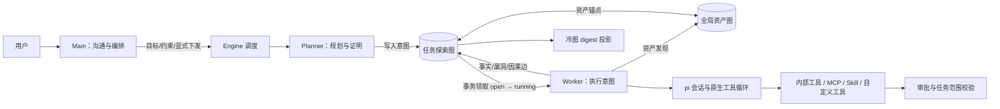

# ARTEX → fate：pi 核心迁移复核与修复

日期：2026-10-17。对照对象为本机 ARTEX（`a0cc44e`）、用户提供的《ARTEX：AI 自主渗透测试系统项目介绍.html》，以及 fate 当前 TypeScript 实现。以实际源码和可执行测试为判定依据，历史设计文档仅用于追溯意图。

本次已修复任务下发/领取、主聊天越界启动任务、pi 生命周期接线、会话恢复和活动流的主要断点，并恢复冷图投影。**当前仍不等于旧 Go 系统的完整功能迁移**：流量证据、复测、附件、高级模型治理等缺口须继续实现。下文将已实现的核心链路与待实现契约分别列明，避免把配置 CRUD 当作运行能力。

## 1. 保留的架构与边界

资产图保存全局资产实体及关系；每个任务的探索图保存目标、意图、事实和漏洞证据。`exploration_anchors(node_id, asset_id)` 连接两图。worker 领取的是探索意图，运行范围来自任务授权与锚定资产；执行结果分别进入资产图、事实节点和漏洞节点，不能只留在聊天文本里。



四角色的代码边界如下。数据库工具绑定只能缩小可用集合，不能为编排角色加入执行能力。

| 角色 | 状态与职责 | 执行边界 |
| --- | --- | --- |
| goals | 初始目标分解，短期内存会话 | 目标相关领域工具，不开放系统执行工具 |
| planner | 每轮重新读黑板，待办持久化 | 查询、意图、目标证明、worker 控制；终局轮禁止派发 |
| worker | 每个意图独立目录和 JSONL 会话 | 原生 bash/read/write/edit、领域写回、经绑定的 MCP/自定义工具 |
| mainagent | 按任务/聊天分段恢复对话 | 查询、目标/约束、显式派发与纠偏；不直接执行目标探测 |

保留 ARTEX 的领域设计，不保留 norma 的模型循环。pi 负责模型调用、工具循环、扩展事件、技能加载、对话压缩和会话恢复；Engine 负责业务状态机。图压缩与 pi 的上下文压缩是两个不同层次。

## 2. 已定位的断点与落地修复

| 问题 | 源码原因 | 当前实现 |
| --- | --- | --- |
| 下发后没有 worker 领取 | dispatch 数据库操作未等待；通知先于提交；等待注册与唤醒之间有窗口 | 派发事务操作完成后才唤醒；generation 计数避免丢信号；空队列才等待，有队列立即连续领取 |
| 同一任务重复启动 | 异步初始化及并发 run 没有统一入口 | runtime loading/starting Promise 合并；同一进程内只创建一组调度循环 |
| 聊天导致暂停任务开始执行 | 聊天入口调用 engine.run | mainChat 只加载 runtime；显式 dispatch/新增目标才启动或恢复任务 |
| 主角色拥有执行入口 | SDK 默认工具及外部资源未按职责隔离 | 各角色显式工具集合；外部执行资源只装配 worker；goals 也不继承默认 bash |
| MCP 配置存在但不会调用 | 创建 SDK 会话后没有 bindExtensions，session_start 未触发 | 调用原生扩展绑定；关闭时触发 session_shutdown 并释放资源；真实 stdio 夹具验证调用和 guard |
| 会话“恢复”没有历史 | 首次创建随机文件名，恢复时却使用另一条确定路径；分段未进入文件名 | 首次即打开确定的 SessionManager 路径；主聊天分段独立保存 |
| 连续调用无法收尾 | 只在 agent_before_settle 判断预算，但工具循环可能永不 settle | turn_end 计数和有限收尾；按实际 toolCall 内容中止；墙钟 AbortSignal 兜底 |
| 模型失败被算作成功 | assistant error 未转成业务异常 | 模型错误向 Engine 冒泡并记录；worker 根据完成/预算/取消/失败映射终态 |
| 停止聊天是假操作 | 接口仅写日志，running 始终返回 false | 维护真实运行句柄；stop 取消 SDK 并等待退出；审批等待同步取消 |
| 冷图只剩数据库结构 | 原有冷图执行链没有迁移 | 恢复冷节点判定、轮次、digest、covers 关系及锚点并集；详见下一节 |
| 前端历史和实时活动错位 | worker 名、seq/node_id、main 分段契约不一致；回放与订阅存在空窗 | DTO 归一化；先订阅缓冲再回放快照；完整回放后按游标排空；错误触发重连 |
| 对话没有逐字反馈 | 只记录最终消息，thinking 读取字段也错误 | 原生 text/thinking delta 独立推送；前端合并临时文本并用最终消息替换；不为临时消息请求历史详情 |
| 改模型配置不生效 | resolver 长期缓存，密钥缓存仅看长度；协议强制使用 completions | 每轮重新读配置；按完整 profile 内容哈希缓存；接入 completions/responses/anthropic 原生 provider |
| 自定义工具只有管理页面 | tools 表未转换为 pi 可执行工具 | worker 装配 command/script/shell/http；命令模板参数转义、Python JSON stdin、HTTP 重定向逐跳校验 |

核心实现入口：`apps/server/src/engine/engine.ts`、`agent/roles.ts`、`agent/resources.ts`、`pi/runner.ts`、`pi/modelResolver.ts`、`pi/providerFromProfile.ts`、`tools/custom.ts`、`http/routes/{tasks,exploration,compat}.ts`。前端接线在 `web/src/app/(main)/function/tasks/detail/_tabs/sessions-tab.tsx` 与 `web/src/components/transcript.tsx`。

附带修复：Planner 待办保存到 explorations；追加约束默认保留已有约束，显式 replace 才替换；统计使用完整图计数而非分页长度；启动恢复数据库中正在运行的任务；活动串行持久化，保留工具调用 ID、分段、流 ID 和 token 用量。

## 3. 冷图与双图的一致性

对照 ARTEX `agent/coldgraph.go`、`agent/compaction.go`、`db/digest.go` 恢复核心规则：

1. open/running/paused 意图、它们的所有祖先及直接子节点保持热态。
2. 仅 fact 和已结束 intent 可以折叠；目标、漏洞和 origin 事实保留。
3. 连续冷却至少 6 个 Planner 轮次；按连通块聚合，对共享父节点的孤立兄弟补充分组；单节点不折叠。
4. digest 是派生视图，带 member_ids、covers 边及成员锚点并集。原始节点和关系不删除，node_detail 仍可取回原始证据。
5. 图节点内容/状态、因果边或原节点锚点变化，使任务当前 digest 失效；复活意图不会被旧摘要遮住。

当前使用确定性的抽取摘要，避免额外模型调用；这与 B 的背景模型摘要流程并非完全相同。摘要每节点最多 240 字符、整体最多 6000 字符，只供概览，不能代替证据。pi 的原生会话压缩另外启用，worker mandate 和约束由 system 提供。后续如接模型摘要，仍必须保留成员 ID、版本校验和原文展开入口。

## 4. 资源与配置生效规则

| 资源 | 当前生效方式 | 已知边界 |
| --- | --- | --- |
| LLM | task active profile → task profile → role profile → global active；完整配置哈希缓存 | 新运行读取更新，已经在途请求不强制切换；高级代理/额度/故障切换尚未统一 |
| Skill | 每次会话读取 agent_skill_visibility，交给 pi 原生资源加载器 | 不再无条件把全部技能暴露给所有角色；技能不是独立调度器 |
| MCP | enabled 服务器 + worker 可见性；原生 MCP extension 注册工具 | 已用本地 stdio 真协议夹具验证；远程 Streamable HTTP、旧 SSE 和 insecure 需专项兼容验收 |
| 自定义工具 | enabled + worker 绑定，转为 pi ToolDefinition | command/script/shell/http 运行时已接入；管理测试器和 directory/deferred 元数据尚未完全统一 |
| 工具审批 | 原生 tool_call 扩展调用 guard，自定义命令另检查渲染后的命令 | 取消等待后拒绝未执行操作；外部 MCP 自身的网络出口仍取决于该服务器部署约束 |
| 资产审批 | task_scope 与锚点校验保持独立，不因更换 SDK 改成提示词约束 | 已有 bash 代理属于协作式出口约束，并不是 OS 级网络沙箱 |

## 5. 功能缺口的重设计契约（待实现）

以下不是已完成能力，也不再以“轻量化删除”代替迁移决策。

| 缺口 | 建议职责及数据契约 | 完成验收条件 |
| --- | --- | --- |
| LLM 治理 | 独立 ModelPolicy 层管理 provider 并发、限流、重试和 fallback；每次 attempt 记录 task/role/profile/原因/token；会话仍使用 pi ModelRuntime | 429、超时、失效密钥、用户取消均有确定结果；失败重试不重复提交领域写操作；切换可追溯 |
| 全局任务准入与多实例 | task admission FIFO + DB 租约（owner、expiry、fencing token）；进程本地 Promise 只解决单进程幂等 | 多实例同时领取无重复；崩溃后过期租约可恢复；等待/暂停/取消顺序可测试 |
| 自定义工具管理一致性 | 抽取共享 CustomToolCompiler；管理预检与 worker 运行复用同一编译器；目录、解释器、输入 schema、环境变量和 timeout 明确验证 | 管理页“测试成功”必须对应真实执行结果；无占位成功；每类工具至少成功/失败/取消用例 |
| MCP 传输兼容 | 以 pi createTransport 扩展点适配旧 SSE；用显式传输枚举和连接诊断；不能把旧 SSE 静默当作 Streamable HTTP | stdio/HTTP/SSE 的连接、列举、调用、取消、关闭均通过夹具；失败在会话里可见 |
| 附件对话 | 先建立 Artifact 记录与路径/媒体类型；消息保存 artifact ID；按模型能力转成 pi 支持的输入 | 不支持的类型明确报错；历史重放仍能访问；当前附件请求返回 400，避免假接收 |
| 流量证据与复测 | 恢复独立 EvidenceStore；finding 通过稳定 ID 引用请求/响应/附件；复测创建新的子任务并链接原 finding | 报告可追溯原始证据；复测不覆盖历史发现；原始流量有读取/保留策略 |
| 模板与归档 | 版本化 TaskSpec 保存目标、范围、模型和资源绑定；归档包含图/锚点/活动/会话引用 | 导入校验 schema 版本；模板不复用运行态；归档可恢复且关系完整 |
| 旁路提问、外部资产同步 | 提问使用独立只读会话；同步走资产入库和审批服务，保留来源 | 不启动 worker、不改任务执行状态；同步资产不能跳过授权 |
| 对话体验验收 | SSE delta 渲染节流、长列表虚拟化、分段级 busy/停止、重连状态提示 | 浏览器测试覆盖断网重连、刷新、长输出、多分段、停止时审批中的工具 |

建议按运行可靠性（模型治理/工具契约/浏览器验收）→ 证据闭环 → 辅助模块顺序推进。旧模块对应的 404 清单在 `http/routes/removed.ts`；有入口或配置表不代表功能已经恢复。

## 6. 验证记录与适用范围

测试使用独立 PostgreSQL `series_test`；`SERIES_TEST_PG_DSN` 可覆盖。原测试对业务库的硬编码已改为测试库，资产测试改为建立真实任务夹具，未放松数据库外键。验证没有向真实目标执行扫描，也没有重启现有业务服务。

主要回归覆盖：单 worker 连续领取两个手动下发意图、并发 run 幂等、暂停任务聊天不启动 worker、聊天分段恢复、真正停止正在生成的回复、冷图原证据/锚点与复活、MCP 可见性刷新、原生 stdio MCP 调用、模型错误、连续工具预算、命令参数转义、Python stdin、SSE 回放/增量与分段历史、审批取消。

执行命令：

```bash
cd apps/server
npm test
npm run build
cd ../../web
npm run build
```

本次最终结果：17 个测试文件通过，149 项通过、1 项跳过（共 150 项）；后端 TypeScript 构建与前端 Next.js 生产构建均通过。真实 LLM 联通测试因没有测试配置跳过。本地 faux provider 能验证调度和 SDK 合约，不能证明服务商的所有模型行为或真实浏览器交互已验收。
